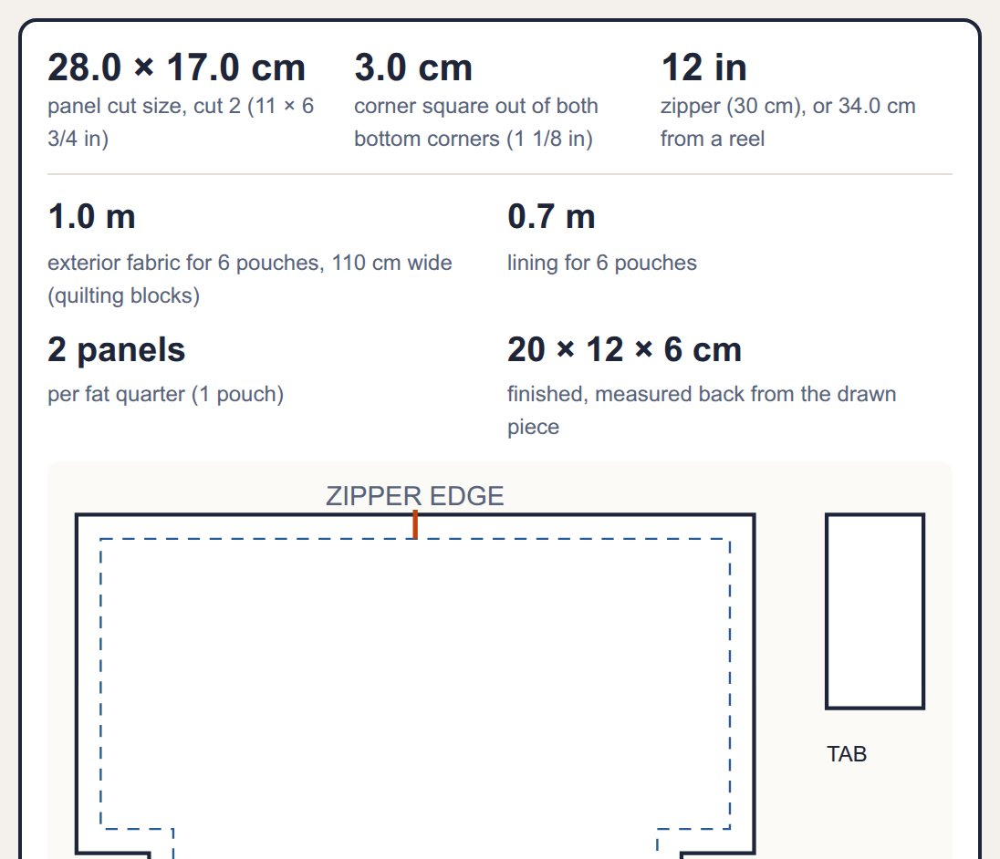

# Zipper Pouch pattern — boxed or flat, 4 sizes + your own

[https://jmshinhwa.github.io/rulestamp-tools/zipper-pouch-pattern/](https://jmshinhwa.github.io/rulestamp-tools/zipper-pouch-pattern/)

## What it does

Zipper pouch pattern with the cut sizes, zipper and fabric worked out for you Zipper pouch sewing pattern drafted by code. Example (made-up): 6 quilted Medium pouches, 20 × 12 × 6 cm. The chart says buy 1.0 m of 110 cm exterior fabric, not the 0.7 m the plain panels need, because each panel is cut 2.5 cm bigger and trimmed after quilting. Buy for the plain panels and that is a 0.3 m shortfall: $4.20 at a made-up $14.00 a metre. Who: home sewists and quilters making zipper pouches, makeup bags and pencil cases, as gifts or to sell. What is in it: 4 sizes (S 12 × 8 × 4 cm to XL 30 × 18 × 10 cm), boxed corners or flat, or your own finished size. A cutting chart in cm and inches for the exterior, lining, quilting block, batting, fusible fleece, loop tab and zipper (closed length or reel cut). Fabric to buy for any number of pouches and panels per fat quarter. A4 and US Letter PDFs with a 10 cm / 4 in test square, page map and the chart on page 1. An A0 copy-shop sheet with all 8 panels, a projector file, and an 8-step sewing guide with line drawings. Seam allowance 1 cm included. Free on the page: one pouch answered on screen, chart, zipper, fabric and cost. Paid, once: the printable files. No photos of a sewn sample: the pieces and the guide are drawings made by code. Digital files, nothing is shipped.

## How to open

Open it in any browser: https://jmshinhwa.github.io/rulestamp-tools/zipper-pouch-pattern/ — nothing to install, your entries stay in your browser. Offline: download this folder and open `index.html`.

## Result after one filled case

## Rule source and date

- The rule is the calculation printed on the page; page checked 2026-11-26.

Save and continue: https://getreadystack.com/apps/zipper-pouch-pattern/
